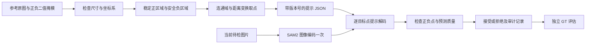

# SAM2 固定参考提示分割工程

从正、负参考原图及二值标注掩模生成固定像素坐标提示，使用冻结权重的 SAM2 对待检图片分割。包括提示构建、版本管理、多目标批量推理、结果拒绝、可视化、离线评估与测试。

**适用条件：参考图和待检图具有相同尺寸、裁剪范围、相机视角，且目标与干扰物的位置足够稳定。** 本工程没有跨图片特征相似度匹配，也没有位置配准或自动坐标缩放。参考原图用于尺寸检查、来源追溯和提示预览；点的位置由标注掩模的几何形状产生。

## 数据流



## 目录

| 路径 | 职责 |
|---|---|
| `sam2_fixed/prompts.py` | 参考样本校验、取点、版本摘要、候选约束检查 |
| `sam2_fixed/runner.py` | 冻结模型、混合精度、编码复用、提示分割 |
| `sam2_fixed/artifacts.py` | 统一保存单通道二值 mask 和独立叠加图 |
| `sam2_fixed/pipeline.py` | 多目标批处理、预热、逐图错误隔离与审计 |
| `sam2_fixed/evaluation.py` | IoU、Dice、接受覆盖率和失败惩罚统计 |
| `sam2_fixed/__main__.py` | build / preview / predict / run / evaluate 命令 |
| `tests/test_engineering.py` | 取点、输入异常、候选拒绝、冻结与流水线测试 |
| `samples/reference_masks/` | 当前完整掩模正负参考样本与配置 |
| `INTERVIEW.md` | 实现讲解、技术取舍及面试追问 |
| `VALIDATION.md` | 本次实际验证记录与未验证范围 |

## 安装

Python 3.10+；推荐 Python 3.12。生成提示、可视化和离线评估只需要图像处理依赖。

```bash
python3.12 -m venv .venv
source .venv/bin/activate
python -m pip install -e .
```

执行模型推理时另外安装 [Meta 官方 SAM2](https://github.com/facebookresearch/sam2)。GPU 机器先按 PyTorch 官方说明安装对应 CUDA 的 PyTorch，再安装 SAM2；本机 CPU 验证采用以下方式关闭 CUDA 扩展编译：

```bash
SAM2_BUILD_CUDA=0 python -m pip install --no-build-isolation \
  'git+https://github.com/facebookresearch/sam2.git@2b90b9f5ceec907a1c18123530e92e794ad901a4'
```

官方安装可能需要先安装 `torch` 和 `setuptools`。发布环境应固定 SAM2 提交及依赖版本；本次实际环境见 `requirements-tested-macos.txt` 和 `VALIDATION.md`。

官方权重与 config 必须配套：

| 权重 | 官方安装包内的 config |
|---|---|
| `sam2_hiera_large.pt`（原项目） | `configs/sam2/sam2_hiera_l.yaml` |
| `sam2.1_hiera_large.pt` | `configs/sam2.1/sam2.1_hiera_l.yaml` |
| `sam2.1_hiera_tiny.pt` | `configs/sam2.1/sam2.1_hiera_t.yaml` |

权重下载链接来自[官方脚本](https://github.com/facebookresearch/sam2/blob/main/checkpoints/download_ckpts.sh)。tiny 可用于集成检查，large 是否适合产线精度与节拍需要实测。

本次工作区已提供官方 tiny 权重及安装好的 `.venv`。复现当前双目标分割可运行：

```bash
python -m sam2_fixed run --pipeline samples/reference_masks/configs/pipeline.json \
  --image samples/reference_masks/positive/circle/image.png \
  --out outputs/another-cpu-run --warmup 1
```

源码压缩包不包含虚拟环境或权重；在其他电脑使用时需要按上述步骤安装，并下载对应权重。

## 准备参考样本

每个分割目标单独建配置，例如 `pole` 与 `weld`。推荐使用独立的单通道黑白 PNG：0 表示背景，255 表示标注区域。也支持视觉内容为黑白/灰度的 RGB、RGBA 和调色板 PNG，透明像素视为背景；彩色原图或彩色叠加图会被拒绝。正掩模标注当前目标，负掩模只标注需要排除的结构，不能把未标注区域都当作负样本。

完整物体轮廓掩模和粗标注区域均可用于取点，不需要改动取点算法。参考原图与其 mask 必须尺寸相同、像素位置对应；拼接预览、截图边框、缩放图不能直接作为原尺寸 mask 输入。目录名称只表达目标类型和样本角色，例如 `samples/reference_masks/positive/circle/`、`positive/square/`、`negative/ellipse/`；模型不按目录名称或物体颜色做识别。

`references.json` 示例，路径相对该 JSON：

```json
{
  "target": "pole",
  "positive": [
    {"image": "reference_01.png", "mask": "pole_01.png"},
    {"image": "reference_02.png", "mask": "pole_02.png"}
  ],
  "negative": [
    {"image": "reference_01.png", "mask": "confusing_circle_01.png"}
  ]
}
```

多个参考样本聚合规则：

1. 正掩模取交集，选取在全部参考图中都属于目标的稳定位置；没有交集则停止构建。
2. 负掩模取并集，再排除任意正参考掩模覆盖的区域，避免把可能属于目标的位置当负点。
3. 对每个连通域做距离变换，优先选离边界最远的位置；额外点受最小间距限制。环形区域的点位于环带，不能用可能处于孔内的几何中心代替。
4. 过小区域可通过 `min_area` 过滤。默认保留所有非空区域；细小目标需显式降低 `boundary_margin`，不偷偷改变标注。
5. 点数超过预算直接报错，不静默丢弃目标。`points_per_component` 是每连通域最多取多少点；空间不足时实际数量可更少。

```bash
python -m sam2_fixed build \
  --manifest references.json \
  --out configs/pole.prompts.json \
  --points-per-component 3 \
  --boundary-margin 2 --min-spacing 12 --max-points 64
```

输出提示 JSON 和 `.preview.png`。坐标为 `(x,y)`，单位是原图像素；正点标签为 1，负点标签为 0。固定配置不生成语义特征原型。

`prompt_id` 包含坐标、参数和参考文件 SHA256；修改配置后必须重新 build。时间戳不参与版本摘要。多样本位移太大时，应拆分工位/型号配置或另行实现配准，不能用扩大正点范围掩盖偏位。

## 先检查待检图片上的点

```bash
python -m sam2_fixed preview \
  --prompts configs/pole.prompts.json \
  --image query.png --out outputs/query.points.png
```

绿点是正点，红点是负点。尺寸不一致时明确拒绝。尺寸一致并不代表物体位置一致，预览与批次验证仍然必要。

## 单目标推理

```bash
python -m sam2_fixed predict \
  --prompts configs/pole.prompts.json --image query.png \
  --config configs/sam2/sam2_hiera_l.yaml \
  --checkpoint models/sam2_hiera_large.pt \
  --device cuda --precision float16 \
  --out outputs/single
```

CUDA 可选 `float16` 或硬件支持的 `bfloat16`；默认 `float32`。CPU/MPS 只启用 float32。混合精度使用有作用域的 `autocast`，不修改全局上下文。使用 `model.eval()`、`requires_grad_(False)` 和 `torch.inference_mode()`，无优化器、反向传播或权重保存步骤。

对每个候选检查所有正点是否在掩模内、所有负点是否在掩模外，以及模型预测质量是否满足阈值。满足约束的候选中取预测质量最高者；没有合格候选时返回 `rejected`，不强制修剪或输出掩模。预测质量分数不是人工标注测得的 IoU。

## 多目标批量流水线

`pipeline.json`：

```json
{
  "model": {
    "config": "configs/sam2/sam2_hiera_l.yaml",
    "checkpoint": "../models/sam2_hiera_large.pt",
    "device": "cuda",
    "precision": "float16"
  },
  "targets": [
    {"name": "pole", "prompts": "pole.prompts.json", "min_score": 0.0},
    {"name": "weld", "prompts": "weld.prompts.json", "min_score": 0.0}
  ]
}
```

`checkpoint` 和 `prompts` 相对 pipeline JSON；`config` 是 SAM2 安装包中的配置名。分数阈值需用独立验证数据确定，0.0 只是功能验证默认值。

```bash
python -m sam2_fixed run \
  --pipeline configs/pipeline.json \
  --image data/batch/*.png \
  --out outputs/run-001 --warmup 1
```

模型只加载一次，每张图只编码一次，各目标独立提示解码；某目标失败仍保留其他目标结果。整体状态按 `error > rejected > accepted` 汇总。每张完成后原子写入报告快照。每次 run 使用空目录，防止混入旧 mask。

输出包括每目标二值 mask、带点的叠加图、逐图 `result.json` 及总 `summary.json`。拒绝或错误时不生成该目标 mask。记录来源摘要、权重摘要、提示摘要、候选检查、设备精度、编码/解码耗时及正式批次 P50/P95/P99。预热单列。读取失败样本不参与模型流水线耗时统计；其计数始终保留。

默认双目标配置推理成功后，每张待检图片输出两张独立 mask：

```text
outputs/run-001/0000/pole.mask.png   # 极柱孔目标
outputs/run-001/0000/weld.mask.png   # 焊脉目标
```

它们为原图尺寸的单通道 PNG，白色（255）为目标、黑色（0）为背景，不含原图或提示点。控制台会打印每张图片的 mask 数量与路径；`result.json` 和 `summary.json` 的每张图片记录也含 `mask_count` 与 `mask_images`。单目标 `predict` 命令按其目标输出一张 mask。目标被拒绝或发生错误时，记录对应状态，不输出伪造的空白 mask。

单个 `FrozenSAM2` 实例有当前图片状态，**不支持并发访问**。服务化时使用单工作队列或每进程独立实例；不能让两个线程交错调用 `prepare()`。

## 独立评估

人工 GT 与参考样本按采集批次分开。`evaluation.json`：

```json
{
  "samples": [
    {"image": "data/batch/001.png", "target": "pole", "mask": "gt/001.pole.png"},
    {"image": "data/batch/001.png", "target": "weld", "mask": "gt/001.weld.png"}
  ]
}
```

```bash
python -m sam2_fixed evaluate \
  --run outputs/run-001/summary.json \
  --manifest evaluation.json --out outputs/run-001/evaluation.json
```

报告接受样本平均 IoU/Dice、接受覆盖率、拒绝数、错误数，并额外给出将拒绝和错误按 0 计的 `failure_penalized_mean_iou`。后者是工程辅助统计，不是标准语义分割 mIoU。不要只报告成功图片的精度；少量样本的 P99 也不能代表稳定产线尾延迟。

## 当前样本与测试

```bash
python -m sam2_fixed build --manifest samples/reference_masks/configs/circle.references.json \
  --out samples/reference_masks/configs/circle.prompts.json --points-per-component 1
python -m sam2_fixed build --manifest samples/reference_masks/configs/square.references.json \
  --out samples/reference_masks/configs/square.prompts.json --points-per-component 1
python -m unittest discover -s tests -v
```

当前样本的完整掩模沿用此前分割结果作为演示参考，来源见各样本的 `provenance.json`，不能用于证明独立测试精度。真实 SAM2 集成测试默认跳过，提供权重后启用：

```bash
SAM2_TEST_CHECKPOINT="$PWD/models/sam2.1_hiera_tiny.pt" \
SAM2_TEST_CONFIG=configs/sam2.1/sam2.1_hiera_t.yaml \
python -m unittest discover -s tests -v
```

## 清理后的项目

旧的专用演示脚本、合成示例生成器、多轮历史输出和项目缓存已删除。唯一正式入口为 `python -m sam2_fixed`。当前结果保存在 `outputs/latest/`，包含 `0000/circle.mask.png`、`0000/square.mask.png` 及推理记录；新推理请指定新的空输出目录。

模型权重和 `.venv` 已保留，可以继续直接运行。清理记录见 `evidence/cleanup.json`；当前源码包不包含权重和虚拟环境。

## 工业交付边界

目前输出的是分割掩模及推理接受/拒绝状态，不是最终产品 OK/NG。尺寸量测还需要相机标定、像素到毫米换算及测量重复性验证；3D 凹凸检测、PLC/机器人通信、异常图回流及权限管理不在本次代码范围。

固定点可能在工件偏位后落到另一结构上，即便通过点约束，也不能保证语义正确。投入实际检测前应覆盖位置公差、反光、遮挡、目标缺失、异常焊脉和换型边界，并用真实数据评估拒绝策略及量测误差。
